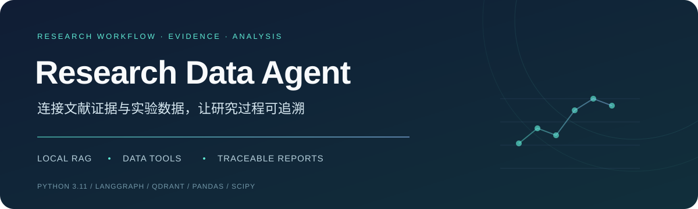
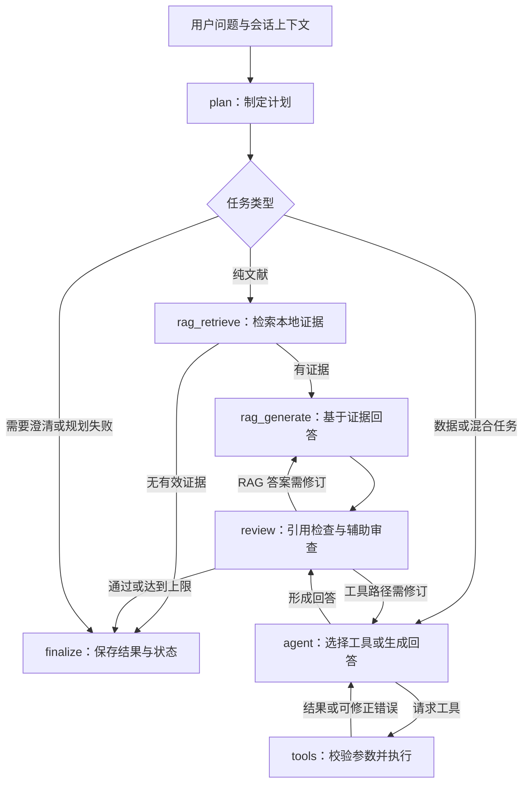

<div align="center">



# 科研文献与实验数据分析 Agent

**从一个研究问题出发，连接本地文献、实验计算与可追溯报告。**


[项目亮点](#highlights) · [示例任务](#example) · [工作流程](#workflow) · [快速开始](#quickstart) · [开发路线](#roadmap)

</div>

---

研究资料往往分散在论文 PDF、实验 CSV 和分析脚本中。本项目将这些环节组织进一个 LangGraph 工作流：模型负责理解问题和选择工具，Python 工具执行计算，检索模块提供原文证据，最终保存回答、图表、参数和来源。

**项目定位：面向科研学习与实验分析的单用户命令行 Agent 原型。** 当前已实现核心流程，并通过 36 项离线测试；真实模型端到端效果仍待系统验证。测试结果记录于 2026-10-15，属于本地验证，尚未配置 CI。

<a id="highlights"></a>
## ✨ 项目亮点

| 能力 | 实现方式 | 带来的价值 |
| :--- | :--- | :--- |
| **文献与数据协作** | 一个任务中多轮调用本地检索、筛选、统计和绘图工具 | 将研究依据与实验结果放在同一份报告中 |
| **独立 RAG 路径** | 纯文献任务先检索，再基于当前证据生成回答 | 避免跳过检索，资料不足时明确返回状态 |
| **完整数据计算** | 保存完整快照，以 `dataset_id` 交给下游工具 | 预览只展示几行，计算仍覆盖完整筛选结果 |
| **可修正的工具调用** | Function Calling + Pydantic 校验 + 错误反馈 | 模型可根据报错修正参数，重试有次数上限 |
| **有来源的回答** | 原文片段绑定证据 ID、文件名与页码 | 可以追溯关键回答使用了哪些材料 |
| **跨轮会话** | SQLite 保存历史任务、工具参数和数据集信息 | 同一会话可围绕已有分析继续提问 |
| **可检查的分析过程** | 保存数据哈希、工具结果、节点轨迹和报告 | 将模型文字与实际计算记录对照核查 |
| **无密钥离线演示** | 合成数据 + 模拟文献 + 脚本化模型 | 不调用 API，也能体验统计、绘图与报告保存 |

<a id="example"></a>
## 🔬 一个具体任务

> 分析 `experiment.csv` 中 30 分钟的记录。以 `mouse_id` 为实验单位，比较 `age_group` 中 young 与 old 两组的 `signal`。两组为独立样本，请使用双侧 Welch 检验，绘制分组图，检索本地文献，并保存带来源的报告。

**适用前提：** 文件包含上述字段；分组标签、时间单位和统计设计已明确；文献检索需要预先建立本地知识库。

| 阶段 | 系统会做什么 | 可核查的结果 |
| :--- | :--- | :--- |
| 规划 | 判断需要数据分析与文献证据，识别缺失信息 | 任务计划；必要时向用户澄清 |
| 筛选 | 从原始 CSV 选择指定记录，保存完整数据 | 数据集 ID、记录数、筛选条件与文件哈希 |
| 分析 | 调用分组统计、两组比较和绘图工具 | 均值、标准差、组间差值、置信区间、p 值和图表 |
| 检索 | 查询本地 PDF / Markdown 知识库 | 原文片段、来源文件、页码和证据编号 |
| 审查 | 检查引用编号，辅助检查回答与工具结果的一致性 | 审查状态及未解决问题 |
| 保存 | 关联回答、原始计算记录、引用与产物 | Markdown 报告、图片、JSON 记录；按请求导出 CSV |

### 离线演示可以得到什么？

运行 `--demo` 会生成 8 条合成记录，使用脚本化模型驱动真实计算工具：

| 合成分组 | 样本数 | signal 均值 |
| :--- | ---: | ---: |
| young | 4 | 13.00 |
| old | 4 | 6.00 |

两组均值差为 **7.00**，双侧 Welch 检验 **p ≈ 0.00861833**。程序同时生成分组散点图、完整数据 CSV 和 Markdown 报告。

> **这是软件功能演示。** 数据、文献和模型决策均为模拟；统计计算与绘图由实际工具执行。这些数值不能支持真实生物学结论，也不代表真实模型的任务成功率。

<a id="workflow"></a>
## 🧭 工作流程



图示为主要执行路径；调用预算耗尽、工具异常或运行中需要澄清时，也会进入保存阶段。普通问答复用 `agent` 路径，可以不调用工具。

**当前执行方式为串行。** 模型可以在一轮提出多个工具请求，程序依次执行；尚未实现文献与数据分支并行，也未实现独立子 Agent 分工。

## 🧰 工具箱

工具通过统一注册表管理：**名称 → 用途描述 → 参数模型 → Python 执行函数**。模型接收工具说明和参数 Schema，本地代码负责校验与执行。

| 工具 | 用途 |
| :--- | :--- |
| `request_clarification` | 缺少必要信息时向用户提问，暂停本次任务 |
| `select_rows` | 按多个 AND 条件筛选 CSV，保存完整数据集 |
| `filter_dataset` | 兼容原有的 `time` 区间筛选 |
| `summarize_groups` | 分组计算数量、均值、样本标准差、中位数等 |
| `compare_groups` | 对已明确的两个独立组执行双侧 Welch 检验 |
| `plot_groups` | 绘制分组散点和均值线 |
| `export_dataset` | 导出完整筛选数据，独立于预览行数限制 |
| `search_literature` | 检索本地文献，返回证据 ID、原文与页码 |

当前执行已注册的 Python 工具，不开放模型生成任意 Python 或 SQL 的执行能力。数据概览工具未注册到主流程。

<a id="quickstart"></a>
## 🚀 快速开始

当前验证环境为 **Windows / PowerShell + Python 3.11**。从项目根目录执行下面的命令。

### 1. 下载并安装

```powershell
git clone https://github.com/shen970297-gif/research-data-agent.git
cd research-data-agent
python -m venv .venv
& .\.venv\Scripts\python.exe -m pip install -r requirements-lock.txt
```

`requirements.txt` 列出直接依赖，`requirements-lock.txt` 记录已验证环境的完整依赖版本。

### 2. 先跑无密钥演示

```powershell
& .\.venv\Scripts\python.exe .\src\main.py --demo
```

演示不读取真实实验数据、不需要 `.env`、不调用模型 API。输出路径会打印到终端，文件保存在 `reports/offline_demo/` 下。

### 3. 配置真实模型

```powershell
# 保留已有配置，只在文件不存在时复制模板
if (-not (Test-Path .env)) { Copy-Item .env.example .env }
New-Item -ItemType Directory -Force data/uploads | Out-Null
```

在本机 `.env` 中填写配置：

| 配置项 | 作用 | 模板值 |
| :--- | :--- | :--- |
| `LLM_MODEL_ID` | 对话模型名称 | `glm-4-flash` |
| `LLM_API_KEY` | 模型服务密钥 | 留空，运行前自行填写 |
| `LLM_BASE_URL` | 模型接口地址 | 智谱 OpenAI 兼容接口 |
| `LLM_TIMEOUT` | 单次模型请求超时，单位秒 | `120` |
| `EMBEDDING_MODEL` | 建库与查询使用的向量模型 | `embedding-3` |

对话与 Embedding 配置目前共用 `LLM_API_KEY` 和 `LLM_BASE_URL`。真实对话、建库和检索可能产生服务商 API 费用。

### 4. 准备自己的数据与文献

```text
data/
├── uploads/           # 自己的实验 CSV
└── reference/         # PDF 论文与 Markdown 参考资料
```

仓库附带三份示例 Markdown 资料，不包含真实实验数据、论文 PDF 或向量索引。

首次使用文献检索前建库：

```powershell
& .\.venv\Scripts\python.exe .\src\build_vector_store.py
```

数据分析任务不需要文献索引。新增文献后若要替换已有索引，明确执行：

```powershell
# 替换原 collection，并重新调用 Embedding API
& .\.venv\Scripts\python.exe .\src\build_vector_store.py --rebuild
```

### 5. 开始提问

```powershell
# 连续对话，输入 exit 退出
& .\.venv\Scripts\python.exe .\src\main.py --session my-study

# 单次任务：需要先放入具有对应字段的 experiment.csv
& .\.venv\Scripts\python.exe .\src\main.py "筛选 experiment.csv 中 time 等于 30 的记录，展示 5 条。" --session my-study
```

沿用同一个 `--session` 可以使用近期任务上下文，换一个名称则开启独立会话。会话名允许 1–64 位字母、数字、下划线或连字符。模型读取最近 6 轮任务摘要及最近 20 个数据集元数据，完整历史保存在 SQLite 中。

## 📦 输出与可追溯性

每个真实任务使用独立的 `run_id`，结果保存在：

```text
reports/runs/<run_id>/
├── result.json          # 回答、状态、执行分支和引用来源
├── trace.json           # 节点顺序、调用次数、工具事件与未解决问题
├── manifest.json        # 数据来源、文件哈希、证据和产物路径
├── tool_results.json    # 成功工具调用的参数与结果（有成功调用时）
├── ds_*.json            # 完整数据快照（执行筛选时）
├── groups_*.png         # 分组图（调用绘图时）
├── ds_*.csv             # 完整数据导出（调用导出时）
└── report.md            # 分析报告（用户要求保存报告时）
```

报告包含问题、任务状态、计划、回答、程序写入的计算记录、引用原文和文件产物。模型正文与原始工具结果分别保留，方便复核。

| 状态 | 含义 |
| :--- | :--- |
| `completed` | 程序检查及辅助审查通过 |
| `needs_input` | 等待补充必要信息 |
| `insufficient_evidence` | 纯文献路径未找到有效证据 |
| `needs_review` | 回答仍存在引用或审查问题 |
| `partial` | 预算或运行异常导致任务未全部完成 |
| `failed` | 规划阶段失败 |

`completed` 不代表科研结论经过专家确认；引用编号有效，也不代表引用必然支持对应论断。

## 🧪 验证与运行约束

```powershell
& .\.venv\Scripts\python.exe -m unittest discover -s tests -v
```

**当前离线测试：36 项通过。** 使用假模型、假检索器和合成数据，覆盖工具执行、参数修正、会话保存、数据完整性、RAG 引用、资料不足及调用预算等关键行为；不调用真实 LLM 或 Embedding API。

<details>
<summary><b>调用预算与错误修正</b></summary>

- 默认所有规划、执行、审查合计最多 **12 次模型调用**。
- 默认最多 **32 次工具调用**、**2 次回答审查**。
- 同一工具连续失败允许首次调用后最多 **3 次参数修正**，同时受全局预算约束。
- 最后一次模型调用仍请求工具时，不再执行这些工具。
- 网络异常不会触发无限重试；未完成任务会标记状态并保留已完成记录。

</details>

<details>
<summary><b>统计分析的适用范围</b></summary>

- 计算使用完整数据快照，`max_rows` 只限制给模型展示的条数。
- CSV 采用 Pandas 默认类型推断与缺失值规则；相关缺失记录的排除数量会反馈，不自动剔除异常值。
- 指定实验单位后，同单位同组的重复记录默认报错；仅在明确同意时用 `repeated=mean` 聚合。
- 两组比较要求明确实验单位、独立组设计和 Welch 方法；每组至少 2 个有效单位，拒绝跨组重复 ID。
- 暂不支持配对检验、多组检验、多重比较校正、重复测量或混合模型。
- 不根据自然语言猜测时间单位、分组含义或因果关系。原始 CSV 内容变化后，需要重新筛选。

</details>

<details>
<summary><b>检索与会话的当前边界</b></summary>

- 当前知识库为本地 Qdrant，默认分块参数为 1000 / 150；已有索引需重建才应用新参数。
- 纯文献路径默认最多检索 5 个片段，相似度阈值 0.5，并过滤空白、重复片段。
- 纯文献回答仅允许引用本次检索证据；无有效证据时停止生成，不使用旧证据补齐答案。
- 审查失败后可以在同一批证据上修订；纯文献路径尚未自动补检索或降低阈值。
- 相似度分数不等于证据可信度，实验条件是否可比仍需要人工判断。
- 会话保存用于后续对话，不是任务中断后的自动断点续跑。
- 当前为单用户串行 CLI；无多人鉴权和并发会话写入协调。不要用两个进程同时打开同一个嵌入式 Qdrant 目录。

</details>

## 🗂️ 代码导航

| 模块 | 关键文件 | 职责 |
| :--- | :--- | :--- |
| 入口 | [main.py](src/main.py) | 命令行、会话选择、结果展示 |
| 工作流 | [research_agent.py](src/research_agent.py) | LangGraph 节点、条件路由、审查和预算 |
| 工具循环 | [tool_agent.py](src/tool_agent.py) | Function Calling 消息配对、执行反馈与停止条件 |
| 工具注册 | [tool_registry.py](src/tool_registry.py) | 描述、参数模型与执行函数的映射 |
| 参数规范 | [research_schema.py](src/research_schema.py) | 规划、统计、检索与审查的数据模型 |
| 实际工具 | [research_tools.py](src/research_tools.py) | Pandas / SciPy / Matplotlib 计算和检索适配 |
| 检索与生成 | [retriever.py](src/retriever.py) · [rag_pipeline.py](src/rag_pipeline.py) | 文献检索和证据增强提示词 |
| 文档入库 | [load_documents.py](src/load_documents.py) · [split_documents.py](src/split_documents.py) · [build_vector_store.py](src/build_vector_store.py) | 加载、清洗、分块与向量化 |
| 存储 | [research_storage.py](src/research_storage.py) | SQLite 会话、数据快照、哈希与运行目录 |
| 报告 | [research_report.py](src/research_report.py) | 引用检查、计算附录与 Markdown 输出 |
| 演示与测试 | [offline_demo.py](src/offline_demo.py) · [tests](tests) | 无密钥体验与离线回归验证 |

**建议阅读顺序：** `main.py → research_agent.py → tool_registry.py → research_tools.py`，然后再看存储、检索和测试。原有筛选相关模块保留兼容；`day4_research_agent.py` 与 `tool_agent.py` 的脚本入口也会进入统一 CLI。

<a id="roadmap"></a>
## 🛠️ 开发路线

- [x] LangGraph 规划、工具循环、审查与结果保存
- [x] 数据筛选、完整快照、分组统计、Welch 比较、绘图和导出
- [x] 独立 RAG 路径、证据编号与页码引用
- [x] 参数校验、有限修正与全局调用预算
- [x] SQLite 跨轮会话、运行日志与 Markdown 报告
- [x] 合成数据离线演示与 36 项离线测试
- [ ] 真实模型与真实科研任务的端到端评估
- [ ] 专业术语对照表、混合检索、重排序与证据不足时补检索
- [ ] 文献和数据分支并行、独立子 Agent 协作
- [ ] 联网文献来源与 MCP 工具接入
- [ ] 网页交互界面、文件上传和过程展示
- [ ] 更多统计设计与分析工具
- [ ] CI 自动测试、检索质量、任务成功率、耗时与成本评估

## 📚 设计参考

研究规划、执行、来源整理与审查的职责划分参考 [GPT Researcher](https://github.com/assafelovic/gpt-researcher/tree/3582a6841fe7dc801e2a34e34ee408641aea9bce)。本项目在原有 Python 项目上独立扩展，保留面向实验 CSV 的工具与校验逻辑；没有引入该项目的完整运行时。

## 💬 交流与反馈

欢迎通过 [Issues](https://github.com/shen970297-gif/research-data-agent/issues) 提出使用问题、复现步骤和功能建议。反馈时可以附上任务状态、报错类型及最小合成数据示例，请移除密钥和未公开科研数据。

---

<div align="center">

**让每一次分析，都留下可以检查的计算与证据。**

[回到顶部](#科研文献与实验数据分析-agent)

</div>
